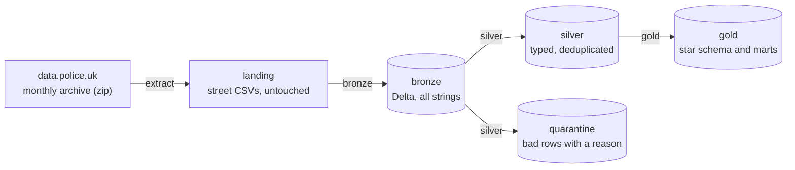
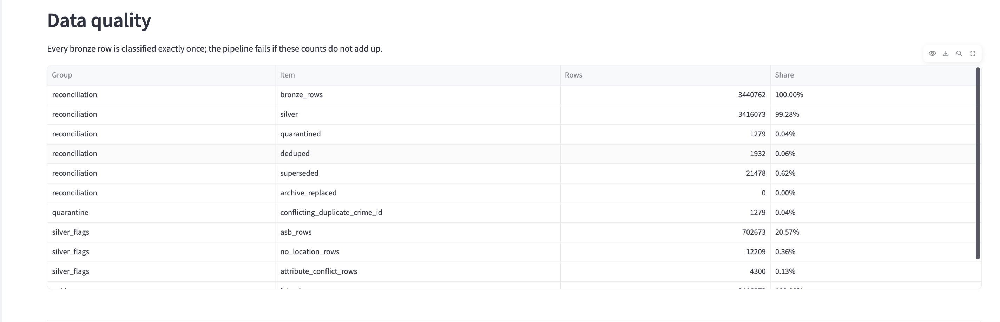

# London Crime Lakehouse

Metropolitan and City of London Police street-level data from police.uk. Extract, bronze and silver work for any force in the police.uk archive (which excludes Greater Manchester); gold's force names and the borough views are London-specific.

A local PySpark and Delta Lake ELT pipeline over that street-crime data, with a star schema and marts on top.

PySpark 4 · Delta Lake · Python 3.12 · uv · pytest · GitHub Actions

**Live dashboard: <https://london-crime-lakehouse.streamlit.app/>**

[](https://github.com/Daudsaid/london-crime-lakehouse/actions/workflows/ci.yml)

## What it does

It downloads the monthly archives from [data.police.uk](https://data.police.uk/data/archive/) and builds a medallion lakehouse (landing, bronze, silver, gold) over 36 months of Metropolitan Police and City of London Police street-crime records, about 3.4 million rows. Every row is accounted for: it ends up in silver, in a quarantine table with a reason, or in one of three named duplicate classes, and the pipeline asserts that the counts add up on every run. It is written so that the layers can move to Databricks (Auto Loader, Lakeflow Declarative Pipelines, Unity Catalog, Lakeflow Jobs); that move is on the roadmap and has not been done.

All figures in this README come from a real run on archive 2026-08.

## Architecture



| Layer | Contract |
| --- | --- |
| [Extract](src/uk_crime/extract.py) | Moves bytes only. Streams the zip, verifies it, renames it into place atomically, and lands the street CSVs under `archive=YYYY-MM/month=YYYY-MM/` with their original names. |
| [Bronze](src/uk_crime/bronze.py) | Adds metadata (archive month, data month, force, source file, ingestion time) and nothing else. Every column stays a string, nothing is cleaned or dropped, and it is the replayable source of truth. |
| [Silver](src/uk_crime/silver.py) | Typed, cleaned, deduplicated and quality-checked. Rows that fail go to a quarantine table with one reason each. Rebuilt in full from bronze on every run. |
| [Gold](src/uk_crime/gold.py) | Reads only silver. Five dimensions, one fact table and five marts (including two per-borough marts), written with Spark SQL over temp views. |

## Key engineering decisions

- **ELT with a replayable bronze.** Bronze keeps the source columns as strings, so any later rule change can be replayed without re-downloading. The CSV header is checked against an explicit schema, so a changed header fails the load instead of shifting columns. See [bronze.py](src/uk_crime/bronze.py).
- **Idempotent at archive level, atomic landing.** An archive is built in a temporary folder and renamed into `landing/` as a whole, so a failed download never leaves a half-landed archive. Bronze loads one archive with Delta `replaceWhere`, so re-running gives the same counts. See [extract.py](src/uk_crime/extract.py).
- **Newest archive wins at file grain.** Archives overlap, so for each force and month silver uses only the file from the newest archive that contains it. The rule is implemented and unit-tested, but only archive 2026-08 is loaded so far, so its `archive_replaced` count is 0 in the real run.
- **A data-driven rule for duplicate Crime IDs.** 21,564 Crime IDs repeat within a file (0.79% of groups) and 92% of those differ between copies, usually because one copy has a real outcome and the other a placeholder. Quarantining every conflicting copy would have lost 19,861 Crime IDs (0.73% of all groups); the outcome-precedence rule loses 599 (0.02%), and the profiling shows that the row it keeps always agrees with the outcomes files. See [the profile](docs/duplicate-crime-ids.md) and [profile_duplicate_crime_ids.py](analyses/profile_duplicate_crime_ids.py).
- **Quarantine, never drop.** Each bronze row lands in exactly one of five classes, and the run fails if they do not sum to the bronze count. A quarantine guardrail stops the write if any single reason exceeds 0.5% of rows. Unknown outcome or crime-type values raise instead of being quarantined.
- **Cross-table consistency without multi-table transactions.** Delta commits one table at a time, so every silver and gold row carries the run id that produced it, and `assert_silver_consistent()` and `assert_gold_consistent()` fail if the tables come from different runs. Gold calls the silver check first. See [silver.py](src/uk_crime/silver.py).
- **Schema changes are opt-in.** Each derived table has its expected schema defined in code. If the existing table differs, the run fails and names the added, removed and changed columns; `--allow-schema-change` is the only way to rebuild with a new schema. Bronze never changes this way.
- **An outcome maturity window set from the data.** Recent months have not had time to receive outcomes, so the outcome mart leaves out the newest 16 months, chosen as the smallest cutoff that keeps every remaining month within 2 percentage points of the baseline, and one outlier month (2024-10). See [profile_outcome_maturity.py](analyses/profile_outcome_maturity.py) and the [curve](docs/data-caveats.md#outcome-maturity).

## Data quality in numbers

Reconciliation from the last run of `make pipeline` (archive 2026-08, 3,440,762 bronze rows):

| Class | Rows | Share |
| --- | --- | --- |
| Silver (kept) | 3,416,073 | 99.28% |
| Superseded (placeholder copy replaced by the progressed copy) | 21,478 | 0.62% |
| Deduped (identical copy collapsed) | 1,932 | 0.06% |
| Quarantined (`conflicting_duplicate_crime_id`) | 1,279 | 0.04% |
| Archive replaced (older archive's copy of a file) | 0 | 0% |
| **Total** | **3,440,762** | **100%** |

- No row was unparseable (0 corrupt records), and none failed the month, Crime ID or coordinate checks.
- Anti-social behaviour has no Crime ID: 702,673 rows (20.4%) are kept and never deduplicated.
- 12,209 silver rows have no coordinates (0.36%). They are kept, with `has_location = false`.
- 4,300 silver rows are flagged `dq_attribute_conflict`: copies disagreed on crime type or location and the row with the real outcome was kept.
- Gold: `fct_crimes` has 3,416,073 rows, equal to silver, and no fact key is orphaned. `mart_monthly_crimes` sums to the same figure. The outcome mart's 1,424,734 rows plus 1,207,365 immature and 81,301 excluded rows make up the 2,713,400 non-ASB rows.

## Sample outputs

Top five London LSOAs by recorded crime, 2025-09 to 2026-08 (anti-social behaviour counted separately). These are counts, not rates: there is no population or footfall denominator, so they show where crimes were recorded, not where residents are at higher risk.

| LSOA | Authority | Crimes | ASB |
| --- | --- | --- | --- |
| Westminster 013G | Westminster | 10,107 | 738 |
| Westminster 018A | Westminster | 7,062 | 710 |
| Westminster 013B | Westminster | 6,824 | 483 |
| City of London 001F | City of London | 6,309 | 95 |
| Hillingdon 031A | Hillingdon | 4,890 | 1,107 |

Outcome shares for three crime types. The period is 2023-09 to 2025-04, excluding 2024-10: later months are left out because their outcomes are not mature yet, and 2024-10 is excluded as an outlier (see [outcome maturity](docs/data-caveats.md#outcome-maturity)).

| Crime type | Rows | No further action | Charged or court | Pending | Out of court | Other organisation |
| --- | --- | --- | --- | --- | --- | --- |
| Burglary | 82,940 | 92.6% | 5.7% | 1.5% | 0.1% | 0.0% |
| Violence and sexual offences | 398,522 | 85.1% | 6.6% | 5.1% | 1.1% | 2.0% |
| Vehicle crime | 153,027 | 98.1% | 0.9% | 0.9% | 0.0% | 0.0% |

## Dashboard

The dashboard is live at <https://london-crime-lakehouse.streamlit.app/>. A small [Streamlit](dashboard/app.py) app reads a committed snapshot of the gold layer (`dashboard/data/`: six Parquet files and a `snapshot.json`, 223 KB in total), so it needs neither Spark nor a pipeline run. A sidebar selector picks "All London" or one of the 33 boroughs, and the choice is kept in the URL (`?borough=Camden`), so a view can be shared; an unknown name falls back to All London. For the selection it shows:

- headline figures: crimes in the last 12 months, anti-social behaviour share, and the charged-or-at-court share for mature months, plus a line giving the borough's share of London's recorded crime
- monthly records by crime type, and the top crime types of the last 12 months
- outcome groups by crime type, stating the period and the excluded outlier month
- a map of the selection's LSOAs, zoomed to fit, and its ten LSOAs with the most crimes
- the reconciliation table, and a footer with the snapshot's archive month, silver run id and links to this repository and [the data caveats](docs/data-caveats.md)

Every borough view carries the caveat that these are counts, not rates (there is no population denominator yet) and cover London LSOAs only.



```bash
make dashboard   # first run installs the optional dashboard dependency group
make export      # refresh the snapshot from gold, after make pipeline
```

The app imports no project code, and [`dashboard/requirements.txt`](dashboard/requirements.txt) pins only its own dependencies, so it can be deployed on its own (for example to Streamlit Community Cloud).

[`export.py`](src/uk_crime/export.py) reads gold only, after checking that every gold table comes from one silver run, and refuses to export if silver's run summary belongs to a different run than the gold tables.

## Data caveats

The full list, with numbers, is in [docs/data-caveats.md](docs/data-caveats.md). The ones that matter most:

- **Coverage is partial.** Greater Manchester is absent from the archive, the set of forces varies by month, and only the Metropolitan and City of London forces are ingested.
- **Some Metropolitan records are outside London.** 12,868 of 3,378,444 Metropolitan rows with an LSOA (0.38%) fall in LSOAs outside London. Their monthly number ran between 224 and 681 until 2026-04 and between 20 and 35 from 2026-05; the cause has not been checked. The ranking mart covers London LSOAs only.
- **Recent outcomes are incomplete.** The share of rows with a placeholder outcome rises from about 2% for older months to 43% for 2026-08, which is why the outcome mart leaves out the newest 16 months.
- **Rankings are counts, and tiers are a judgement.** The crime severity tiers and outcome groups are this project's own mappings, not official classifications.

## Quick start

Prerequisites: Java 17 and [uv](https://docs.astral.sh/uv/). Developed on macOS; CI runs on Ubuntu 24.04.

```bash
git clone https://github.com/Daudsaid/london-crime-lakehouse.git
cd london-crime-lakehouse
uv sync
make help        # list the targets
make pipeline    # extract --latest, then bronze, silver and gold
make test        # fast tests
```

`make pipeline` downloads the latest archive, which is about 1.7 GB, so the first run depends on your connection (the first download took about 50 minutes on a home connection). It needs roughly 7 GB of disk in total: the zip, the landed CSVs and the Delta tables. The first Spark run also downloads the Delta jars. With the archive already landed, bronze to gold took about 5 minutes on an 8 GB Apple-silicon Mac; running `make pipeline` again skips the download.

Each stage is also a target (`make extract`, `make bronze`, `make silver`, `make gold`), and extra flags go through `ARGS`, for example `make silver ARGS=--allow-schema-change`. Settings such as the data directory and the forces ingested are read from environment variables in [config.py](src/uk_crime/config.py).

## Project structure

```text
src/uk_crime/
  config.py         every path and setting (environment-overridable)
  spark.py          local SparkSession with Delta
  extract.py        download, verify and land the street CSVs
  bronze.py         landed CSVs to a Delta table, all strings plus metadata
  silver.py         typing, data-quality rules, R5 deduplication, quarantine
  gold.py           dimensions, fact table, marts
  export.py         small Parquet snapshot of gold for the dashboard
dashboard/          Streamlit app and its committed data snapshot
tests/              188 tests with small in-memory fixtures
analyses/           read-only profiling scripts behind the rules above
docs/               duplicate Crime ID profile and data caveats
Makefile            pipeline, test, lint and profile targets
.github/            CI workflow and Dependabot
CLAUDE.md           the engineering rules the project follows
```

## Testing and CI

There are 188 tests, none of which touch the network or `data/`. They use small fixtures and cover:

- landing: a tiny zip built in a temp folder, retry and no-retry cases, atomic landing and idempotency
- bronze: metadata parsing, kept corrupt rows and header drift
- silver: every deduplication case, the order of the data-quality rules, vocabulary errors, reconciliation, the quarantine guardrail, run-id consistency and the schema-change path
- export and dashboard: the exported files and columns, the stale-summary refusal, the loading functions, and the page itself rendered headlessly from the committed snapshot
- gold: the dimensions and their UNKNOWN members, financial-year boundaries, key uniqueness, referential integrity, mart reconciliation, the silver consistency gate and re-run determinism

`make test` runs the 164 fast tests in about 103 seconds. The 24 end-to-end tests that write real Delta tables are marked `slow`; `make test-all` runs all 188 in about 6 minutes (374 seconds). Both were measured on an 8 GB Apple-silicon Mac, and both use the optional dashboard dependency group. CI ([ci.yml](.github/workflows/ci.yml)) runs ruff, the format check and the fast tests on every push, adds the slow tests on pull requests to `main`, and caches the Delta jars. Dependabot proposes weekly updates for the actions and the Python dependencies.

## Roadmap

- Move to Databricks: Auto Loader for landing to bronze, Lakeflow Declarative Pipelines for silver and gold (the transformations are already plain DataFrame functions and the quarantine maps to expectations), Unity Catalog volumes and tables, Lakeflow Jobs for orchestration, and Declarative Automation Bundles (formerly Databricks Asset Bundles) for deployment.
- Add ONS population data so rankings can be rates per resident.
- Fetch only the configured forces' files from the archive with HTTP range requests, instead of downloading the full 1.7 GB zip.
- Keep outcome history as a slowly changing dimension (SCD Type 2) instead of only the latest outcome.

## Author

Daud Abdi · [GitHub](https://github.com/Daudsaid) · [LinkedIn](https://linkedin.com/in/daudabdi0506)
